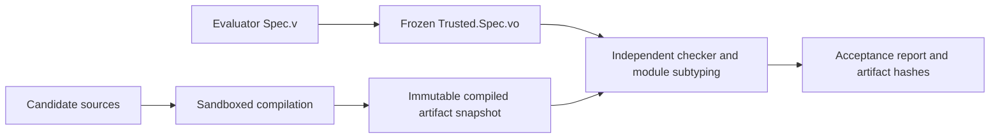

# Checking AI-generated programs and proofs

An evaluator writes a normal `Spec.v` containing a module type named `SOLUTION`.
The AI submits `Candidate.v`, exporting a module named `Implementation`. The
acceptance gate independently checks the compiled libraries and asks Rocq's
kernel whether the submitted module satisfies the frozen signature.

The candidate controls its program, proof scripts, helper source files, notation,
and compiler diagnostics. It does not control the specification, axiom policy,
toolchain, build commands, kernel gate, or namespace mappings used for acceptance.

The sandbox is **gVisor + seccomp**, running native **Rocq 9.3.0**,
**Rocq Stdlib 9.2.0**, and **stdpp 1.13.0**, pinned in
[coqcp-toolchain.opam](../coqcp-toolchain.opam). The kernel and Rocq VM remain
trusted. Native conversion, dynamic plugins, subprocesses from submitted code,
and asynchronous proofs remain disabled. Approved tactic plugins are statically
linked. The compiler and independent acceptance checker run in separate, fresh
sandboxes. There is no unsandboxed fallback.

The specification, execution semantics, module-subtyping gate, and axiom policy
are preserved. gVisor uses the native OCaml runtime and installed `.vo`
libraries. See the [gVisor maintainer guide](GvisorRuntime.md).

## Installation

Install Docker with a running local daemon and give the evaluator user access to
it (GitHub-hosted Ubuntu runners already provide this). Then install the pinned
proof dependencies and gVisor:

```sh
sudo apt-get update
sudo apt-get install ca-certificates curl git python3 build-essential ocaml opam libgmp-dev libseccomp-dev pkg-config m4 rsync unzip util-linux
sudo install -d -o "$(id -un)" -g "$(id -gn)" /opt/rocq
bash tools/install-toolchain.sh
bash tools/install-gvisor.sh
export PATH=/opt/rocq/9.3.0/bin:$PATH
rocq --version
rocq makefile -f _CoqProject -o Makefile
make -j2
python3 tools/adversarial/check.py build
```

`install-gvisor.sh` installs checksum-pinned gVisor `release-20261005.0`, including
its required sidecars, configures the separately named `coqcp-gvisor` Docker
runtime, and builds a small Ubuntu 24.04 image with native runtime dependencies.
It preserves other daemon settings and restarts Docker. Its `systrap` platform
requires no KVM device or nested virtualization. Checking uses Docker on every
invocation; the daemon and runtime are evaluator infrastructure. Run the checker
as a non-root user. Inputs retain that user's ownership inside the sandbox.
Only installed runtime directories from `/opt/rocq/9.3.0` are mounted; opam state,
downloads, and build logs are excluded.

gVisor always disables networking and filters socket operations.

Upgrading the toolchain, runtime, or container image invalidates frozen bundles.
Rebuild the project and gate, prepare specifications again, and record new IDs.

## Write the specification

The small [Increment specification](../verification/increment/spec/Spec.v) is:

```coq
From CoqCP Require Import Options.

Definition required (program : nat -> nat) : Prop :=
  forall input, program input = S input.

Module Type SOLUTION.
  Parameter program : nat -> nat.
  Parameter correct : required program.
End SOLUTION.
```

`program` and `correct` are mandatory signature fields. Additional fields are
supported by Rocq's ordinary module subtyping. The signature itself and the
submitted implementation must not be unapplied functors. Helper functors are
allowed and their stored bodies are audited.

`Parameter` inside a module type expresses an interface requirement. It does not
add a global axiom when a concrete implementation supplies that field. In
contrast, an implementation that simply declares its program or admits its proof
introduces assumptions, which the policy rejects by default.

For competitive programs, specify successful execution and the complete output
stream. A statement that only constrains output _if execution succeeds_ can let
an always-failing program satisfy the requirement. Keep input bounds and memory
semantics on the trusted side too. For interactive programs, require the exact
flush snapshots as well.
[the Permuted Binary Strings specification](../verification/permuted-binary-strings/spec/Spec.v)
binds the program to the generated entry point and requires successful full
execution with all query/reply boundaries; see
[End-to-end verification](EndToEndVerification.md).

## Freeze the evaluator's specification

```sh
python3 tools/adversarial/check.py prepare \
  --spec verification/increment/spec/Spec.v \
  --bundle .verification/increment-bundle
```

Preparation snapshots the project's registered compiled libraries, renames the
specification to `Trusted.Spec`, compiles it in the sandbox, and independently
checks its dependency closure. The bundle contains:

- `spec/Spec.v` and `spec/Spec.vo`;
- the compiled project libraries under their existing logical namespaces;
- `manifest.json`, containing SHA-256 file hashes, the toolchain fingerprint,
  exported interface identities, the axiom policy, and the baseline audit.

Build the project libraries first. Preparation snapshots their
evaluator-controlled `.vo` files; it does not certify their correspondence to
source text.

The command prints JSON with a `spec_id`. **Record that ID in evaluator-controlled
storage.** It is the SHA-256 hash of the manifest. The checking command requires
that original ID; accepting an ID supplied by the candidate would let the
candidate substitute a different bundle and recompute its hashes.

By default, the allowed axiom set is empty (`--axiom-policy none`). An evaluator
can instead select the exact set already trusted by project CI:

```sh
python3 tools/adversarial/check.py prepare \
  --spec verification/knapsack/spec/Spec.v \
  --bundle .verification/knapsack-bundle \
  --axiom-policy ci \
  --cpu-seconds 600 --wall-seconds 1200 --memory-mib 4096
```

The shared policy is [trusted_axioms.json](../verification/trusted_axioms.json).
Its only current entry is
`Stdlib.Logic.FunctionalExtensionality.functional_extensionality_dep`.
Both the project `rocq check` CI job and the submission checker reject every axiom
outside this set. There is no option to supply an arbitrary name or regex.
The kernel gate embeds the same fixed set at build time and also rejects
unapproved names when invoked directly. Names refer to declarations in the
frozen specification and fingerprinted system libraries.

Policy changes require a reviewed change to the trusted CI infrastructure,
rebuilding the gate, and freezing new specification bundles. Evaluators must
use their approved infrastructure revision; a candidate's policy file is not
an authority. Allowed axioms remain logical assumptions, not proof obligations
that the tool discharges. Reports list the axioms actually encountered, which
may be a subset of the selected policy.

Rocq 9.3 also reports inductives that rely on its default treatment of indices
when generating universe constraints. The shared policy records the six existing
declarations reported by project CI: `eq_true`, `eq`, `if_spec`, `eq_dep`, `null`,
and `TCEq`, each under its fully qualified trusted library name. The kernel gate
embeds this set too and rejects further declarations with that property.
This records the behaviour of the pinned standard libraries, including ordinary
equality. The `none` policy excludes axioms while retaining these base theory
declarations. Changing this set also requires rebuilding and freezing new bundles.

## Submit a program and proof

A submission is a dedicated directory containing only top-level `.v` files,
including `Candidate.v`. Names must be ASCII Rocq identifiers. Symlinks, special
files, subdirectories, precompiled libraries, project files, and build scripts
are rejected. At most 128 sources and 8 MiB of source text are accepted. The
source-count bound accommodates the complete Koxia proof chain (74 files);
the byte, artifact, memory, CPU, and filesystem limits remain enforced.

For the increment contract, `Candidate.v` can contain:

```coq
From CoqCP Require Import Options.
Require Trusted.Spec.

Module Implementation.
  Definition program : nat -> nat := S.
  Lemma correct : Trusted.Spec.required program.
  Proof. intro input. reflexivity. Qed.
End Implementation.
```

Helper files are compiled under `Submission`, and can be required with names
such as `Submission.Helper`. The build worker uses `rocq dep` to order the submitted
sources and invokes the evaluator-owned `compile-safe` compiler. It never invokes a submitted Makefile,
`_CoqProject`, shell command, or package-install script.

Each source runs in a fresh native compiler process inside the bounded worker
container. Each compiler writes its `.vo` into a fresh unpredictable directory.
After that compiler exits successfully, the trusted worker captures the bounded
regular file and publishes it under the expected library name for later
dependencies. Additional `.vo` outputs are rejected. The worker verifies earlier
outputs against captured bytes before each compilation and before returning
artifacts. Captured bytes remain in worker memory, so later sources cannot
replace an earlier result sent to the kernel gate.

The AI can develop against a copy of the specification. The evaluator must keep
its bundle and recorded ID outside the AI's writable submission environment.

## Check a submission

Use the specification ID printed during preparation:

```sh
python3 tools/adversarial/check.py check \
  --bundle .verification/increment-bundle \
  --spec-id YOUR_RECORDED_SPEC_ID \
  --submission verification/increment/candidate \
  --output .verification/increment-result
```

Bundle and result directories must be new when they are created. Choose fresh
names for subsequent runs; the tool refuses to overwrite previous artifacts.

The checking command prints a JSON report and exits zero only for acceptance.
Once a result directory is created, it stores `report.json`, the submitted source
snapshot, and any compiled `.vo` artifacts. Admission failures such as an invalid
bundle ID print rejection JSON without creating a result directory. Reports
include the specification ID, source and artifact hashes, toolchain fingerprint,
resource limits, actual axioms, and the stage at which a failure occurred.

The certificate concerns the **compiled module artifacts identified by those
hashes**. Compiler logs and pretty-printed statements are never evidence of
acceptance. Source hashes provide provenance; they are not a separate proof that
an arbitrary compiler or plugin faithfully translated the source text.

## How the gate avoids notation deception



The kernel gate is [spec_check.ml](../tools/adversarial/spec_check.ml). It links
`rocq-runtime.checklib`, the same compiled-library loader and checker used by
`rocq check`, plus Rocq's module subtyping implementation. It does not link the
vernacular interpreter or load candidate ML plugins.

In a fresh process, the gate:

1. Registers only evaluator-controlled logical load paths.
2. Calls `Check.recheck_library` on `Trusted.Spec`, `Submission.Candidate`, and
   **every submitted helper library**, with empty `admit` and `norec` lists.
3. Rechecks opaque proof bodies. VM conversion stays enabled and VM bytecode is regenerated from declarations; native conversion remains disabled.
4. Audits global declarations and stored module/functor bodies for unapproved
   axioms, disabled guard/positivity/universe/elimination checks, inductives
   outside the CI set for indices not mattering, impredicative Set,
   definitional UIP, and rewrite rules. Signature parameters are distinguished
   from implementation assumptions; sealed module bodies are examined too.
5. Constructs the canonical module paths `Trusted.Spec.SOLUTION` and
   `Submission.Candidate.Implementation` directly, without looking them up in
   candidate short-name or notation tables.
6. Calls `Subtyping.check_subtypes` with Rocq's checked universe conversion.

The supervisor accepts only strict JSON from the compiler worker and kernel
checker. Duplicate fields, non-standard JSON values, missing or extra fields,
the wrong Rocq version, and axioms outside the frozen policy all fail closed.

The comparison uses kernel conversion and ordinary module subtyping. It does not
compare strings, pretty-printed syntax, proof names, or an AI's explanation.
Extra implementation fields are allowed. Missing fields, a proof about another
program, and an extra unprovided premise fail the required field checks.

For example, a submission may introduce:

```coq
Notation "'required' p" := True (at level 10).
```

It can then prove its fake requirement, but the gate still compares against the
original compiled signature. The regression suite demonstrates rejection of this
case and of namespace shadowing.

## Sandbox and resource boundaries

[gvisor_backend.py](../tools/adversarial/gvisor_backend.py) supervises a fresh
container for each compilation batch or independent kernel check. The runtime
identity binds the container image ID, runsc and sidecar hashes, and exact Docker
runtime settings. A trusted entry point checks gVisor's marker before executing
input. An unavailable runtime, changed profile, or missing marker rejects the job.

[worker.py](../tools/adversarial/worker.py) supervises the compiler.
[sandbox_exec.c](../tools/adversarial/sandbox_exec.c) applies limits and seccomp
before starting the worker, parser, compiler, and gate. The worker may launch
compiler children; submitted tools cannot fork or launch subprocesses. The
statically linked compiler also denies new executable mappings and dynamic ML
loading. Rocq's VM remains available in compilation and independent checking.

Both stages use:

- gVisor's application kernel with `systrap` and networking disabled;
- a non-root guest, all capabilities dropped, and no new privileges;
- a fixed environment, temporary home, and no Rocq startup script;
- read-only installed toolchain directories, evaluator tools, sources, frozen
  bundles, artifacts, and the fingerprinted OCaml standard-library directory;
  recursive bind mounts are disabled;
- no host home, repository root, credentials, or Docker socket;
- read-only root and `/dev`, bounded `/work` and 16 MiB `/tmp` tmpfs mounts;
- denied sockets, process forks, namespace changes, tracing, privileged APIs,
  cross-process memory access, and signaling of the build supervisor;
- denied memory-backed files and IPC objects that could bypass workspace quotas;
- per-process CPU, address-space, file-size, and descriptor limits, plus whole
  container memory and task limits;
- a build supervisor that disables dumpability to protect its captured artifacts.

The host drains stdout and stderr with separate byte bounds and a wall deadline.
On every exit, including timeout or excess output, it forcibly removes the named
container and its descendants. Stopping the Docker client alone is insufficient.

The worker sends artifact bytes back to the coordinator. It does not bind a
writable host directory into the sandbox. Unexpected file names, symlink outputs,
oversized artifacts, and malformed artifact messages are rejected. After the
compiler exits, a separate checker sandbox receives the artifacts read-only.

Default limits are:

| Resource                                              |     Default | CLI option            |
| ----------------------------------------------------- | ----------: | --------------------- |
| Wall time per compilation or checking stage           | 120 seconds | `--wall-seconds`      |
| CPU time per tool process                             |  60 seconds | `--cpu-seconds`       |
| Virtual address space per process                     |    2048 MiB | `--memory-mib`        |
| Writable work tmpfs                                   |     256 MiB | `--work-mib`          |
| Individual output file and total retained `.vo` bytes |      64 MiB | `--artifact-mib`      |
| Compiler diagnostics / checker output                 |       1 MiB | `--log-mib`           |
| Open file descriptors per tool process                |         128 | fixed                 |
| Tasks in a gVisor container                           |         256 | fixed container limit |

gVisor bounds total container memory (including tmpfs) and tasks through Docker's
cgroup limits. Native CPU and virtual-address-space limits apply per tool process;
compilation is sequential and the whole batch has a wall deadline. The container
CPU allocation is capped at one core.
A resource-limit rejection means the attempt was not certified, not that its
mathematical statement is false.

For a public service, add admission rate limits, bounded job concurrency,
artifact retention limits, and worker lifecycle management outside this runner.
Run workers on patched, disposable machines and keep the evaluator's OS,
toolchain, driver, and expected specification IDs trusted. This sandbox reduces
the submission's access; it does not establish correctness of the Linux kernel
or eliminate vulnerabilities in the trusted checker.

## Sound caching

The default evaluator-owned cache is `.verification/cache`. Use `--cache PATH`
to select another private directory, or `--no-cache` with `prepare`, `check`, or
`examples.py` to execute every compiler and kernel operation again. Selftests use
the same cache through `make_sandbox`; their assertions and direct containment,
plugin-payload, and resource-limit probes still execute on every run.

Compilation entries contain the entire successful batch of `.vo` artifacts.
Their keys bind every input file, including helper sources and `Load` inputs,
all frozen bundle bytes, visible file names and permissions, logical namespace,
compiler configuration, and all resource limits. Kernel entries separately bind
all artifact bytes (including unused helpers), the complete frozen bundle,
module/library arguments, axiom policy, and limits. Only successful operations
are stored; rejected proofs, malformed responses, timeouts, and resource failures
are never stored as successful checks. Changing any source in a batch recompiles
that batch. Every restored artifact is verified against its recorded SHA-256,
and cached kernel responses undergo the same strict schema and axiom validation
as fresh responses.

**Both key domains include the complete validation runtime identity.** This
covers validation and compilation sources and binaries, policies, every mounted
toolchain and OCaml runtime file, gVisor binaries and flags, immutable image ID,
Docker engine identity and client binary, and execution user. An edit to the
checker, worker, sandbox, cache logic, or installed runtime invalidates both
compilation and kernel entries. Runtime identity is computed at command startup;
keep the installed toolchain and runtime immutable while a run is active.
Specification IDs remain tied to that runtime.
Bundle IDs, bundle contents, and source admission are validated before any hit;
the gVisor startup probe also runs even when all proof operations are cached.

The cache is trusted evaluator state, just like the toolchain and frozen
specification. Keep it outside the submitting AI's writable environment and all
mounted input, bundle, artifact, and toolchain directories. The default location
is never mounted into the guest. The implementation requires private owned
directories, rejects symlinks and special files, serializes same-key operations,
and publishes verified blobs and manifests atomically. Hashes detect damage;
they are not authentication against a writer allowed to replace trusted state.
Missing, truncated, malformed, or hash-mismatched entries are cache misses.
Reports expose compilation and kernel hit/miss counts under `cache`.

CI restores proof entries for both selftests and examples and saves new entries
only after a successful `push` run on `main`. Pull requests can consume the
base branch's cache but cannot publish through this workflow. This uses
[GitHub's branch-scoped cache access](https://docs.github.com/en/actions/reference/workflows-and-actions/dependency-caching).
The runtime image archive is cached separately with its recipe, archive hash,
and immutable image ID checked on restoration; identical jobs therefore retain
the same image identity. An updated image recipe rebuilds the image and changes
the proof-cache identity. Caches contain no secrets. Retention and deletion are
evaluator maintenance; deleting entries only removes reuse.

## Shipped contracts and checks

Every problem uses `verification/<problem>/spec/Spec.v` and
`verification/<problem>/candidate/`. There is one small specification per
problem; proof helpers are submitted with the candidate. Candidates may import
general `CoqCP` theories. Concrete program proofs are excluded from the frozen
project libraries. See [the layout and commands](../verification/README.md).

| Problem                 | Contract                                                                      |
| ----------------------- | ----------------------------------------------------------------------------- |
| Increment               | Total successor function                                                      |
| Watermelon              | Existence of a division into positive even weights                            |
| Restore Three Numbers   | Reconstruction up to permutation                                              |
| Knapsack                | Successful generated execution and exact decimal encoding of an optimal value |
| Disjoint Set Union      | Generated union refines the abstract model; merge-score bound and attainment  |
| K-th Highest Score      | Successful generated search-loop refinement with truthful oracle queries      |
| Permuted Binary Strings | Complete generated execution, exact bytes, and every flush boundary           |
| Koxia and Bracket       | Complete generated execution and positional-mask optimum count                |

The first three contracts use no axioms. The generated execution contracts use
the CI policy. Each spec defines its own formal scope and input bounds.

Run the acceptance and containment regression suite:

```sh
python3 -m unittest discover -s tools/adversarial/tests -v
```

Example configuration is declarative data in
[`adversarial-examples.json`](../verification/adversarial-examples.json), with an
independent [JSON Schema](../verification/adversarial-examples.schema.json).
It selects each specification, candidate directory, axiom policy, and named
resource profile. Each profile explicitly contains every checker resource limit;
changing a checker default cannot silently change an example's budget.
`examples.py` remains the orchestration entry point and reads these values.

The runner validates configuration before provisioning or creating results.
Its standard-library validator supports the schema keywords used here, rejects
unsupported keywords, and resolves only local references. A full JSON Schema
validator can consume the same files. Additional checks reject duplicate names,
unknown profiles, missing paths, and paths resolving outside the repository.
CI watches both documents.

Run all shipped contracts and retain their bundles, reports, and artifacts:

```sh
python3 tools/adversarial/examples.py --output .verification/example-results
```

The suite covers valid and alternate programs, helper dependency ordering,
notation and namespace deception, extra premises, missing fields, abstract and
functor implementations, the shared CI axiom policy, arbitrary policy rejection,
admitted and unused axioms, weaker decoder and unobserved execution certificates,
unsafe definitions inside unused functors, corrupted libraries, bundle and
manifest tampering, symlinks, precompiled submissions, attempted `.vo` creation
or replacement, and sandbox filesystem, network, fork, timeout, CPU, memory,
output, and disk limits. The suite exercises gVisor, including actual native
plugin payloads and executable-memory lockdown. Missing sandbox support fails
closed.

[The CI workflow](../.github/workflows/adversarial.yml) builds trusted project
libraries, runs the regressions, checks the examples, and uploads the resulting
bundles and certificates. Each Ubuntu 24.04 job installs the pinned gVisor
`systrap` runtime, restores the native proof toolchain, and builds project
libraries. Proof execution requires the local Docker daemon but no KVM device.
These CI regressions check the infrastructure in the proposed commit. A
production evaluator must use its own approved revision, rather than running
the submitting AI's proposed checker, workflow, or specification modifications.

## What a certificate does and does not establish

The gate establishes that the checked compiled module satisfies the frozen
formal specification under its recorded logical assumptions. Specification
review remains necessary, especially when an AI also writes `Spec.v`: an
incorrect model, impossible precondition, or incomplete contract can be proved.

The input/output example checks the repository's Coq execution model. It does
not certify the corresponding generated C++, the TypeScript code generator,
allocation behavior of the host runtime, or a separately supplied executable.
Connecting a certificate to a native executable requires a verified compiler,
checked translation certificates, or an explicitly trusted translation and
build chain that records the relationship to the accepted artifact hashes.

Useful upstream references:

- [Rocq module signatures and subtyping](https://rocq-prover.org/doc/V9.3.0/refman/language/core/modules.html)
- [Compiled-library checker](https://rocq-prover.org/doc/V9.3.0/refman/practical-tools/coq-commands.html#compiled-libraries-checker-rocqchk)
- [Rocq 9.3.0 checker loader](https://github.com/rocq-prover/rocq/blob/V9.3.0/checker/checkLibrary.ml)
- [Rocq 9.3.0 module subtyping interface](https://github.com/rocq-prover/rocq/blob/V9.3.0/kernel/subtyping.mli)
- [Rocq 9.3.0 release](https://github.com/rocq-prover/rocq/releases/tag/V9.3.0)
- [Stdlib 9.2.0 release](https://github.com/rocq-prover/stdlib/releases/tag/V9.2.0)
- [stdpp releases](https://gitlab.mpi-sws.org/iris/stdpp/-/tags)
- [gVisor documentation](https://gvisor.dev/docs/)
- [libseccomp](https://github.com/seccomp/libseccomp)
